# Evaluations
We evaluated the impact of the features we added on MipNeRF360, Tanks&Temples and Deep Blending datasets. [Exposure Compensation](#exposure-compensation) is evaluated separately. Note that [Default rasterizer](#default-rasterizer) refers to the original [3dgs rasterizer](https://github.com/graphdeco-inria/diff-gaussian-rasterization/tree/9c5c2028f6fbee2be239bc4c9421ff894fe4fbe0) and [Accelerated rasterizer](#accelerated-rasterizer) refers to the [taming-3dgs rasterizer](https://github.com/graphdeco-inria/diff-gaussian-rasterization/tree/3dgs_accel).

## Default rasterizer

### PSNR

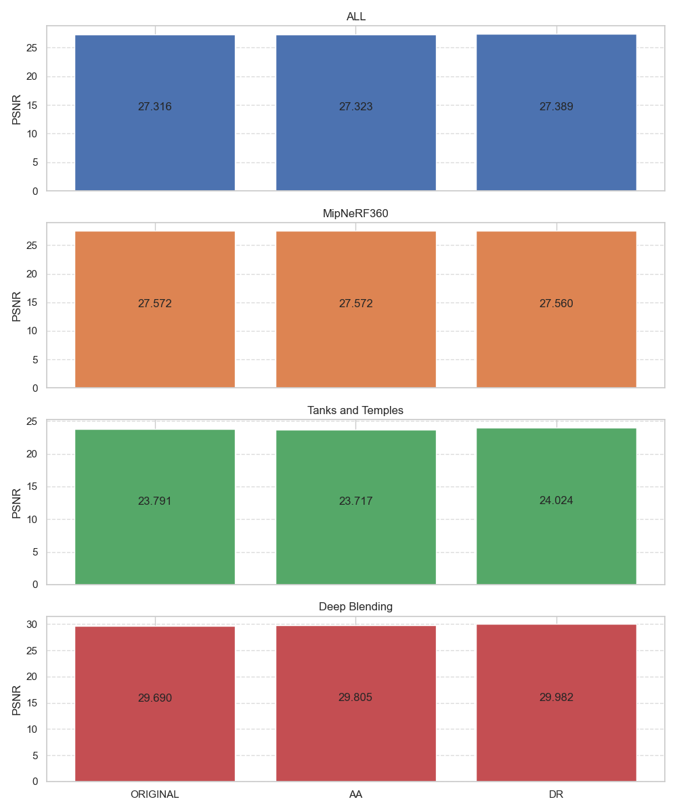

***DR**:depth regularization, **AA**:antialiasing*

<br>

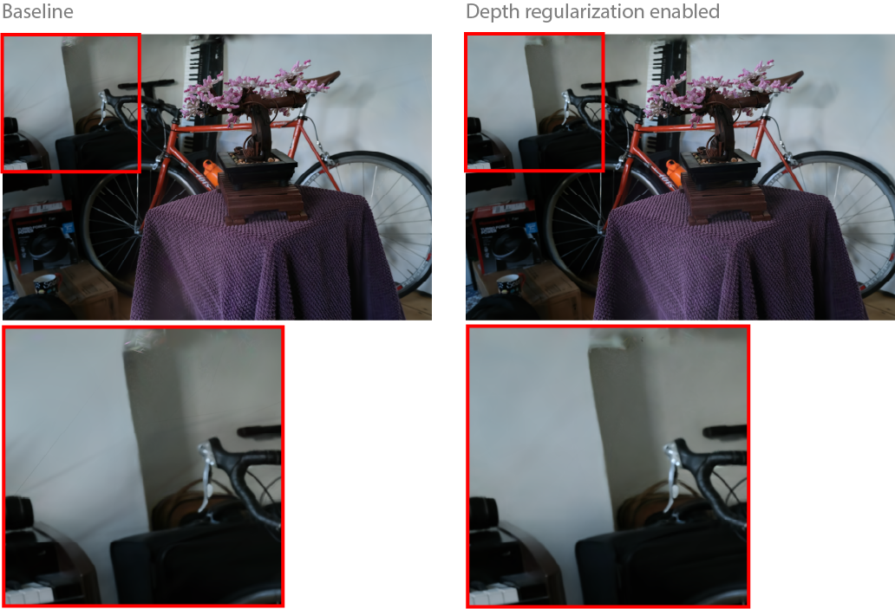

### SSIM


***DR**:depth regularization, **AA**:antialiasing*

### LPIPS
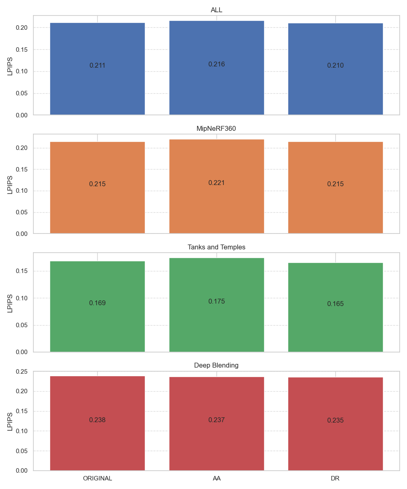

*lower is better, **DR**:depth regularization, **AA**:antialiasing*

## Accelerated rasterizer

### Default optimizer

These numbers were obtained using the accelerated rasterizer and `--optimizer_type default` when training.

#### PSNR
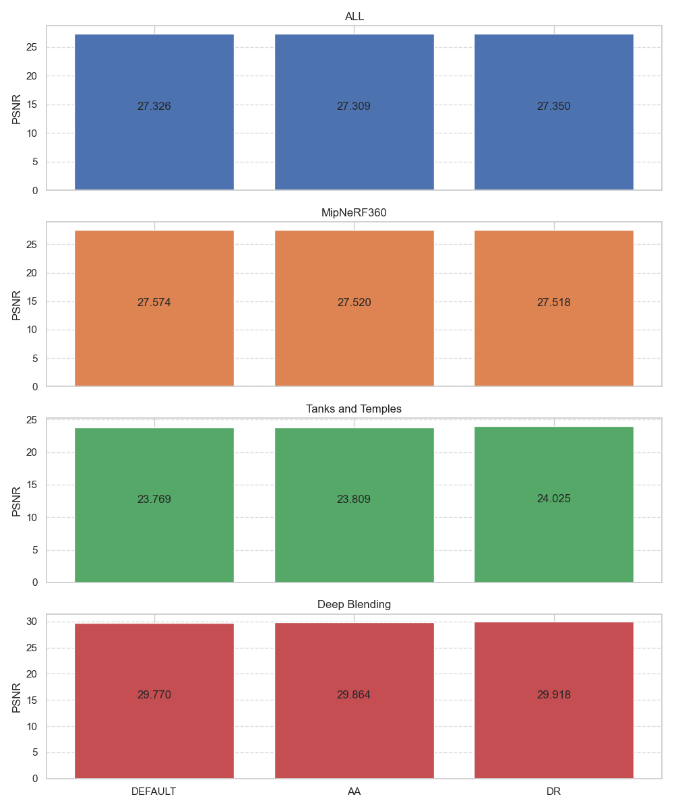

***DR**:depth regularization, **AA**:antialiasing*

#### SSIM
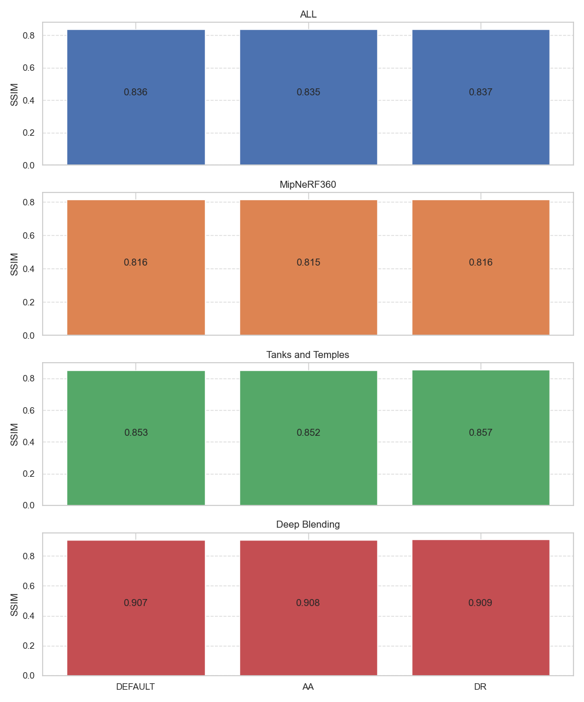

***DR**:depth regularization, **AA**:antialiasing*

#### LPIPS


*lower is better, **DR**:depth regularization, **AA**:antialiasing*

### Sparse Adam optimizer

These numbers were obtained using the accelerated rasterizer and `--optimizer_type sparse_adam` when training.

#### PSNR
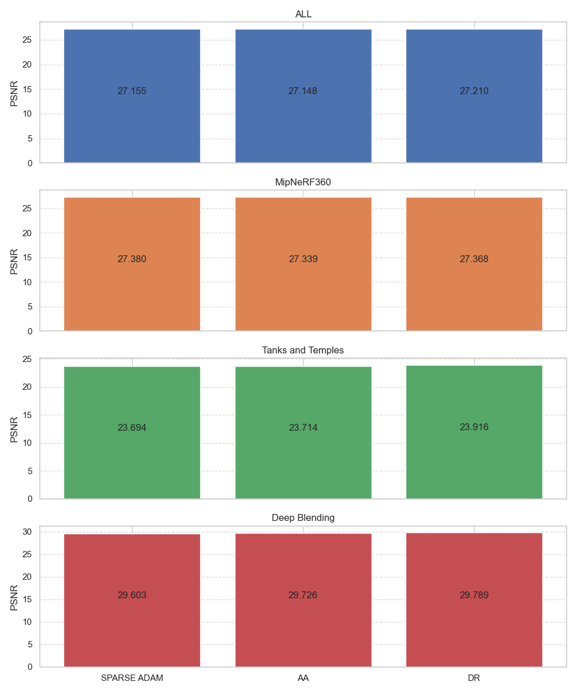

***DR**:depth regularization, **AA**:antialiasing*

#### SSIM


***DR**:depth regularization, **AA**:antialiasing*

#### LPIPS
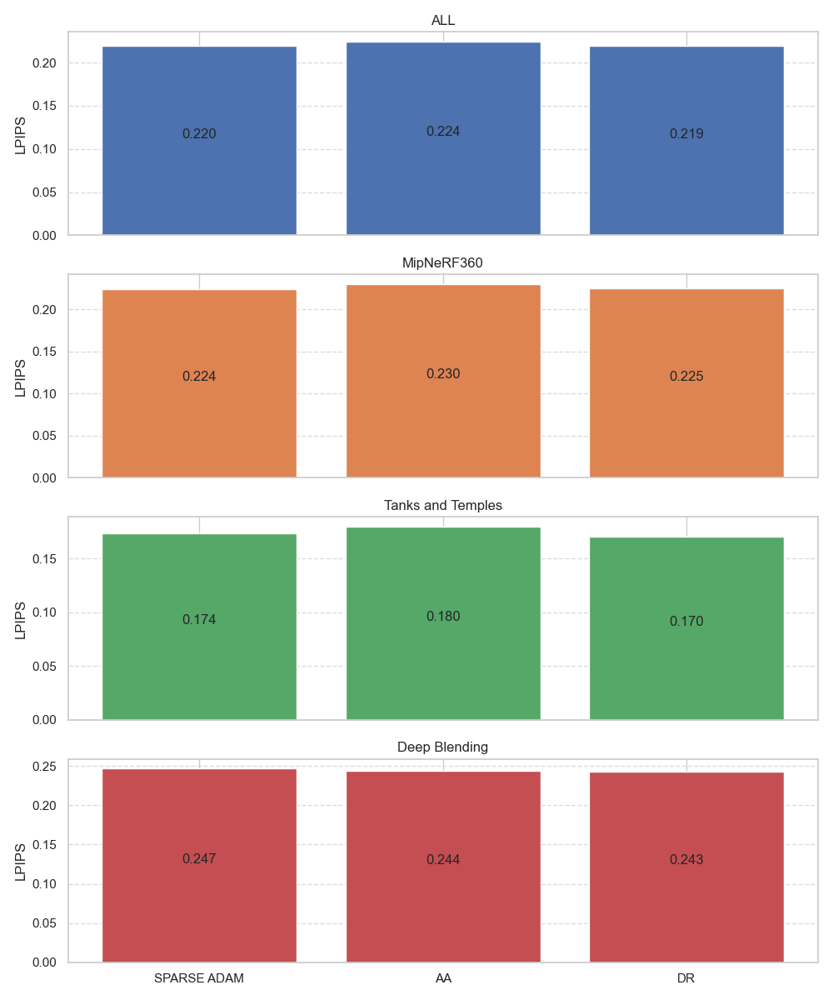

*lower is better, **DR**:depth regularization, **AA**:antialiasing*

## Exposure compensation

We account for exposure variations between images by optimizing a 3x4 affine transform for each image. During training, this transform is applied to the colour of the rendered images.
The exposure compensation is designed to improve the inputs' coherence during training and is not applied during real-time navigation.
Enabling the `--train_test_exp` option includes the left half of the test images in the training set, using only their right halves for testing, following the same testing methodology as NeRF-W and Mega-NeRF. This allows us to optimize the exposure affine transform for test views. However, since this setting alters the train/test splits, the resulting metrics are not comparable to those from models trained without it. Here we provide results with `--train_test_exp`, with and without exposure compensation.

### PSNR

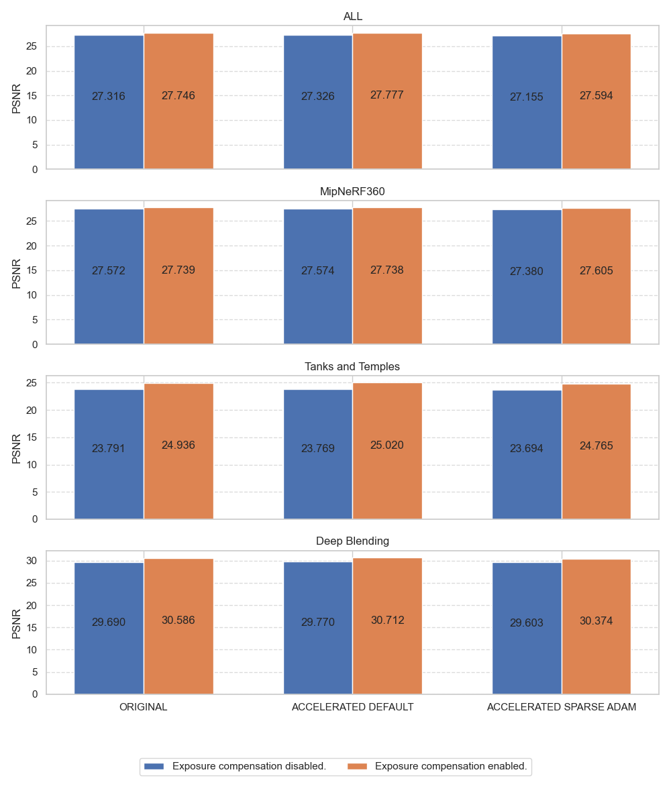

### SSIM

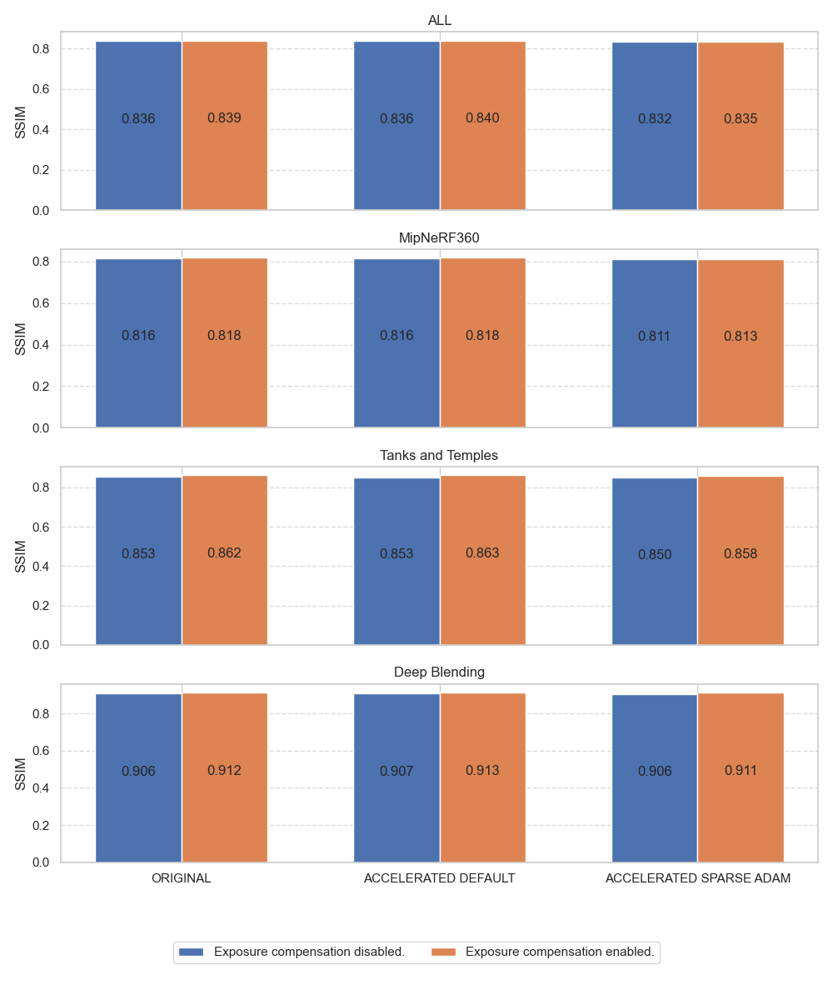

### LPIPS

*Lower is better.*
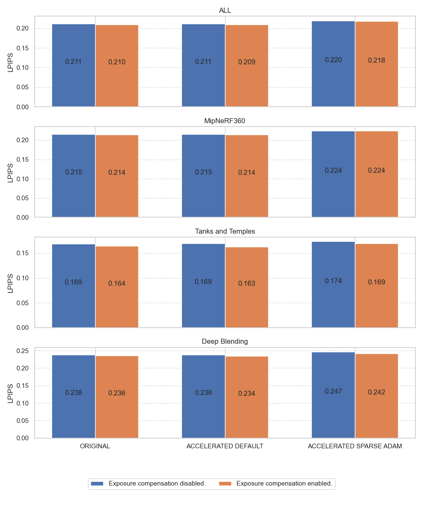

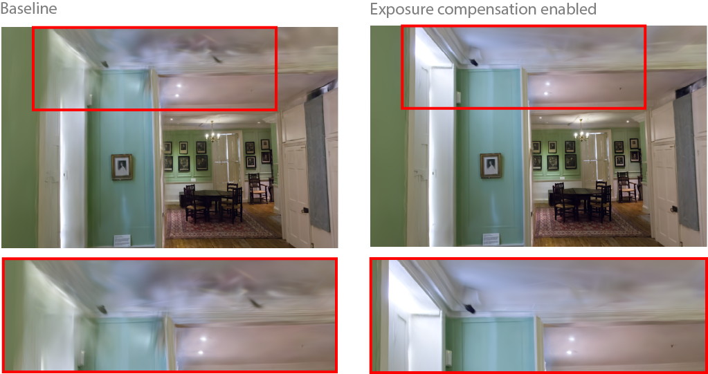

## Training times comparisons

We report the training times with all features enabled using the original 3dgs rasterizer *(baseline)* and the accelerated rasterizer with default optimizer then sparse adam.
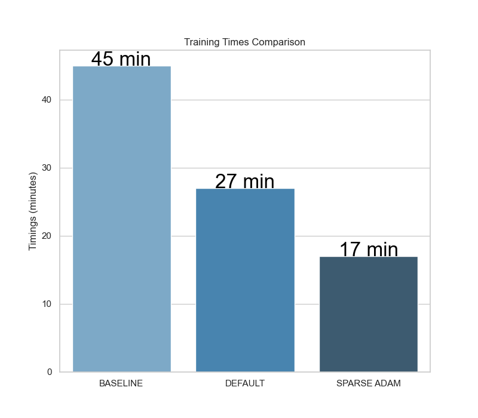

---

# SGDC — segmented density control

Results for this fork's SGDC components (see `docs/sgdc_spec.md`). Everything here
runs in *this* checkout with the `dr_aa` rasterizer, so `base_30k` — the same code
with SGDC off (`--sgdc_enable` omitted) — is the directly comparable baseline.
(`vanilla_30k` in the manifest is upstream graphdeco on the stock rasterizer and
is **not** row-comparable; run it separately when the upstream number is needed.)

## Protocol

- Dataset: Replica `office_0/Sequence_1` (COLMAP scene == `DATASET_DIR`;
  `semantic_class/rgb_<N>.png` GT class labels).
- Split: `--eval` (llffhold=8) for every run, so rows are comparable.
- 30 000 iterations, default densification schedule.
- Metrics via `experiments/metrics.py` → `eval_sgdc.py` (same code path for all
  rows). **Band** = test PSNR on a 4 px dilation of the class-boundary mask;
  **Interior** = test PSNR off the band.
- Runs are seeded in `random`/`numpy` (`safe_state`) but **not** in `torch`, and
  the rasterizer backwards use atomics → run-to-run variance of roughly
  **±0.2 dB PSNR and ±2–3% Gaussian count** (quantified below).

## Summary (office_0/Sequence_1, single run each)

- **Both components independently beat the baseline on the quality-vs-count
  Pareto**: they reach base-or-better PSNR/SSIM/LPIPS at fewer Gaussians
  (B: −5–13% with +0.3–0.4 dB; A.1 alone: −11% with +0.23 dB and tied
  SSIM/LPIPS), and train correspondingly faster.
- **B decomposes into cap + allocation.** The hard capacity cap regularizes
  globally (both global and per-segment beat base on test PSNR); the
  **per-segment allocation** is what moves the boundary band (global control:
  band +0.04 vs base; per-segment: +0.28). The error *weighting* itself does
  nothing (`grad_only` ties the error version).
- **A.1 alone is competitive and perceptual-metric-safe, but does not
  specifically improve boundary PSNR** despite targeting boundaries; stacking it
  on B is not additive.
- **The boundary-semantic components A and C are net-negative** (measured
  separately on the *train* split, see below): A reallocates toward boundaries
  (band +0.20) but collapses interiors (−3.13) → net −2.0 global; C is harmful
  everywhere, including the band it targets.
- Single scene, and run-to-run seed variance is ±0.2 dB — repeats are needed
  before claiming significance.

## Component B — segment-level error budgeting

Hard per-refine budget of `--sgdc_budget_B * N` slots, allocated across segments
by *fixable* error `q_i = |grad_i| * mean_residual_i`
(`--sgdc_budget_enable`; `--sgdc_budget_grad_only` drops the residual term). All
rows below keep Component A neutral (`--f_b 1.0 --f_int 1.0 --eta 0.0`).

| Run | B | Gaussians | Train PSNR | Test PSNR | SSIM | LPIPS | Band PSNR | Interior PSNR | Train (min) |
|---|---|---|---|---|---|---|---|---|---|
| `base_30k`            | —               | 355,256 | 43.50 | 36.50 | 0.9769 | 0.0487 | 31.47 | 39.45 | 16.99 |
| `sgdc_b_30k_B0.02`    | 0.02            | 100,217 | 39.67 | 35.28 | 0.9631 | 0.1180 | 30.66 | 37.42 |  9.95 |
| `sgdc_b_30k`          | 0.05            | 267,931 | 42.81 | 36.86 | 0.9761 | 0.0537 | 31.60 | 39.85 | 15.26 |
| `sgdc_b_30k_B0.05`    | 0.05            | 261,519 | 42.86 | 36.66 | 0.9758 | 0.0539 | 31.41 | 39.66 | 14.43 |
| `sgdc_b_30k_gradonly` | 0.05 (no error) | 260,867 | 42.87 | 36.91 | 0.9762 | 0.0537 | 31.73 | 39.89 | 14.39 |
| `sgdc_b_30k_B0.1`     | 0.10            | 310,566 | 43.23 | 36.79 | 0.9765 | 0.0513 | 31.75 | 39.66 | 16.18 |
| `sgdc_b_30k_B0.15`    | 0.15            | 338,209 | 43.43 | 36.90 | 0.9767 | 0.0497 | 31.68 | 39.91 | 16.98 |
| `sgdc_bglobal_30k`    | 0.10 (global)   | 316,686 | 43.36 | 36.66 | 0.9765 | 0.0504 | 31.51 | 39.68 | 16.05 |

**Observations.**

- B is a clean, monotone capacity knob: Gaussian count tracks `B`
  (100k → 261k → 310k → 338k), quality rises then saturates.
- B dominates the baseline on the Pareto front. At `B=0.10` (310k) test PSNR is
  **36.79 vs base's 36.50 at 355k**; at `B=0.15` (338k) it is **36.90** — i.e.
  ~+0.3–0.4 dB with **5–13% fewer Gaussians**. At `B=0.15` SSIM/LPIPS are
  essentially tied with base (0.9767/0.0497 vs 0.9769/0.0487).
- The **error term does not clearly help**: `grad_only` (36.91, band 31.73) is at
  least as good as the error-weighted version (36.86, band 31.60). Within the
  noise floor the mechanism is dominated by **capacity regularization**, not by
  smarter placement. The residual weighting is an optional refinement.
- Lower Gaussian count also shortens training time (16.99 → ~14–15 min).

**Segmentation attribution — scene-global control (`--sgdc_budget_global`).** At
matched `B=0.10`, ranking candidates globally instead of per segment:

| allocation | Gaussians | Test PSNR | Band | Interior | Δglobal vs base | Δband vs base |
|---|---|---|---|---|---|---|
| per-segment (`sgdc_b_30k_B0.1`) | 310,566 | 36.79 | **31.75** | 39.66 | **+0.29** | **+0.28** |
| global (`sgdc_bglobal_30k`)     | 316,686 | 36.66 | 31.51 | 39.68 | +0.16 | +0.04 |

- The **capacity cap alone** regularizes globally: the global control beats base
  on test PSNR (+0.16) but leaves the **band flat (+0.04)**.
- The **per-segment allocation** is what moves the band: per-segment is +0.24
  band and +0.13 test PSNR over the global control at ~2% fewer Gaussians. This
  is the **only boundary-specific gain** observed across A, A.1, C, and B — and
  it does *not* collapse interiors the way Component A did.
- The **error weighting itself does nothing**: `grad_only` (band 31.73) ties the
  error-weighted version (31.75). Allocation matters; the residual term does not.
- **Caveat:** +0.24 dB is ~1σ at the ±0.2 dB noise floor and is a single run.
  Repeats of per-segment vs global at `B=0.10` are needed to make it significant.

**Variance.** The two identical `B=0.05` runs differ (267,931 vs 261,519
Gaussians; 36.86 vs 36.66 test PSNR). Treat the base-vs-B gaps as ~1.5–2σ
pending repeats; the direction is consistent across both `B=0.05` runs and the
`B=0.10/0.15` points.

## Component A.1 — mask-boundary straddle clone/split

Splits a candidate whose projected mass crosses a semantic boundary
(`|sd| <= k * sigma_perp`, `--sgdc_signal_enable`). Chained after B: the budget
picks candidates, the straddle signal picks clone vs split.

| Run | Config | Gaussians | Train PSNR | Test PSNR | SSIM | LPIPS | Band PSNR | Interior PSNR |
|---|---|---|---|---|---|---|---|---|
| `base_30k`      | —                      | 355,256 | 43.50 | 36.50 | 0.9769 | 0.0487 | 31.47 | 39.45 |
| `sgdc_sig_30k`  | A.1 only (k=1.0)       | 316,501 | **43.64** | 36.73 | **0.9769** | **0.0489** | 31.57 | 39.77 |
| `sgdc_bsig_30k` | B 0.05 + A.1 (k=1.0)   | 247,067 | 43.03 | 36.79 | 0.9757 | 0.0544 | 31.61 | 39.73 |

**Observations.**

- **A.1 alone is a viable standalone:** −10.9% Gaussians vs base with test PSNR
  **+0.23**, SSIM **tied** (0.9769) and LPIPS **tied** (0.0489 vs 0.0487), band
  +0.10, interior +0.32, and the **highest train PSNR** of any run (43.64). So it
  buys compression without a perceptual-metric cost.
- **But it does not specifically help boundaries.** Band is only +0.10 over base
  and is *below* Component B's band at the same tool — despite A.1 targeting
  boundaries. The straddle split behaves more like a mild capacity
  regularizer / better split placement than a boundary-quality booster.
- **Stacking on B is not additive.** `bsig` (B 0.05 + A.1) is 36.79 vs B-alone's
  36.86 / 36.66, band is flat (31.61 vs 31.60 / 31.41), and LPIPS is worse
  (0.0544). Don't combine them blindly.
- **At matched count (~310–316k)** the two have different trade-offs: `B0.10`
  (310k) has higher PSNR/band (36.79 / 31.75) but worse SSIM/LPIPS
  (0.9765 / 0.0513); `A.1` (316k) has lower PSNR/band (36.73 / 31.57) but better
  SSIM/LPIPS (0.9769 / 0.0489).
- **Pending:** a `--sgdc_split_k` sweep (0.5 / 1.0 / 2.0) for A.1, and repeats
  for error bars.

## Components A and C — earlier session (train split)

> **Protocol note.** These were measured in a *separate, earlier* session on the
> **train split** (`sgdc.eval_boundary`, band = 4 px), **not** the `--eval` test
> split used in the B / A.1 tables above. They are therefore **not directly
> comparable** to those rows and are kept separate here. Run ids map to the
> manifest (`sgdc_a_*`, `sgdc_c_*`).

### A — boundary-aware density control

**Round 1** — 30k, train-view PSNR, A sweep:

| Run | Config | Train PSNR | Gaussians |
|---|---|---|---|
| `base_30k` (SGDC off) | — | 41.745 | 530,009 |
| `sgdc_a_30k` | `f_b 0.5, f_int 2.0, dt_norm 100` | 42.273 | 866,915 |
| `sgdc_a_fb1_fi3_dt60_30k` | `f_b 1.0, f_int 3.0, dt_norm 60` | 40.279 | 316,518 |
| `sgdc_a_fb05_fi4_dt50_30k` | `f_b 0.5, f_int 4.0, dt_norm 50` | 40.217 | 522,161 |
| `sgdc_a_fb1_fi6_dt40_30k` | `f_b 1.0, f_int 6.0, dt_norm 40` | 37.835 | 201,792 |

The only config that beat base (`sgdc_a`) did so by adding **+63% Gaussians**. At
matched count (`a_fb05_fi4_dt50`, 522k vs base 530k) it is **−1.5 dB**.

**Round 2** — boundary-restricted eval, train split, band 4 px (A and C together):

| Run | Gaussians | Global | Band | Interior |
|---|---|---|---|---|
| `base_30k` | 534.0k | 43.70 | 38.92 | 45.64 |
| `sgdc_a_fb05_fi4_dt50_30k` | 522.2k | 41.68 | **39.11** | 42.50 |
| `sgdc_c_bnd02_30k` | 498.1k | 42.89 | 37.92 | 44.93 |
| `sgdc_c_bnd10_30k` | 414.3k | 41.94 | 36.54 | 44.29 |
| `sgdc_c_bnd50_30k` | 349.1k | 40.32 | 34.53 | 42.99 |

Deltas vs base:

| Run | Δ global | Δ band | Δ interior |
|---|---|---|---|
| `sgdc_a_fb05_fi4_dt50_30k` | −2.02 | **+0.20** | −3.13 |
| `sgdc_c_bnd02_30k` | −0.81 | −1.00 | −0.71 |
| `sgdc_c_bnd10_30k` | −1.76 | −2.38 | −1.35 |
| `sgdc_c_bnd50_30k` | −3.38 | −4.39 | −2.65 |

**Outcome.**

- **A reallocates exactly as designed** — band +0.20 at *fewer* points — but
  interiors collapse (−3.13), so global is net **−2.02**. Correct mechanism,
  wrong trade-off.
- **C is harmful everywhere**, including the band it targets (−1.00 … −4.39 at
  increasing λ).
- Both are candidates for re-measurement on the `--eval` test split so all six
  rows become directly comparable.

## Reproduce

```bash
python -m experiments.runs --run base_30k
python -m experiments.runs --run sgdc_b_30k
python -m experiments.metrics --run-id sgdc_b_30k
# sweep: run_by_id("sgdc_b_30k", tag=f"B{B}", extra=f"--sgdc_budget_B {B}")
# non-segmented control (same B as sgdc_b_30k_B0.1): --sgdc_budget_global
```

